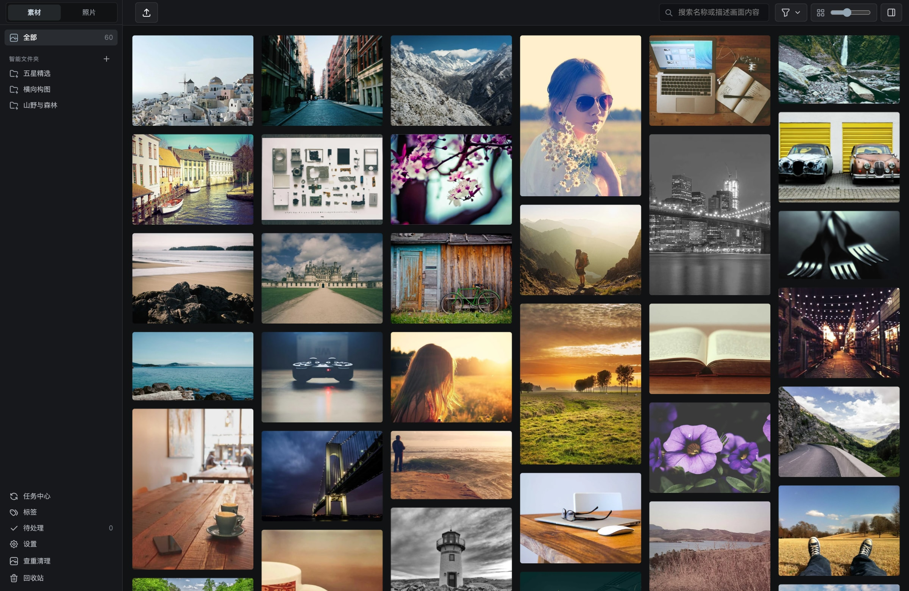
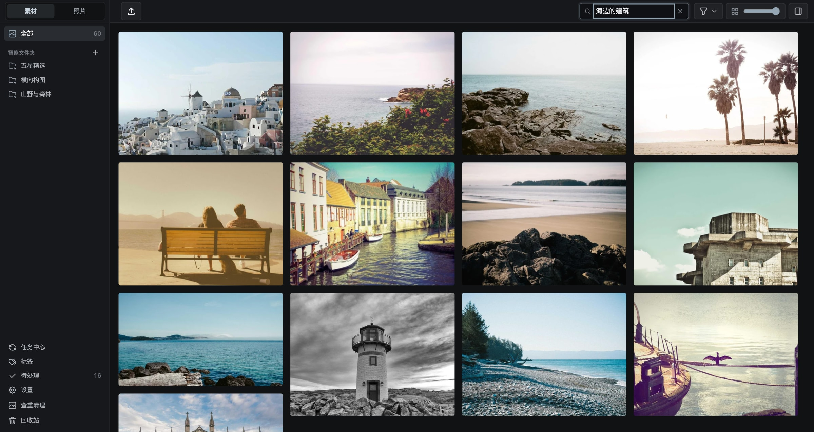
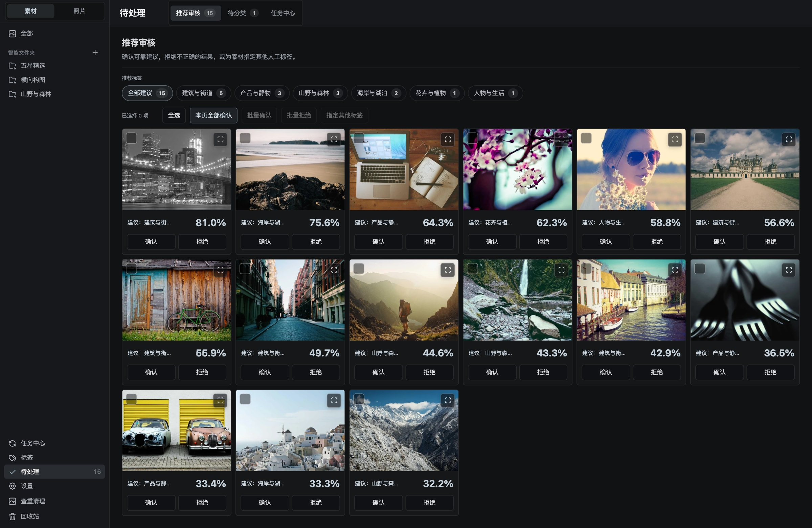
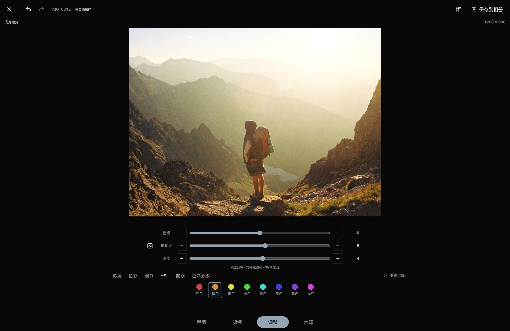
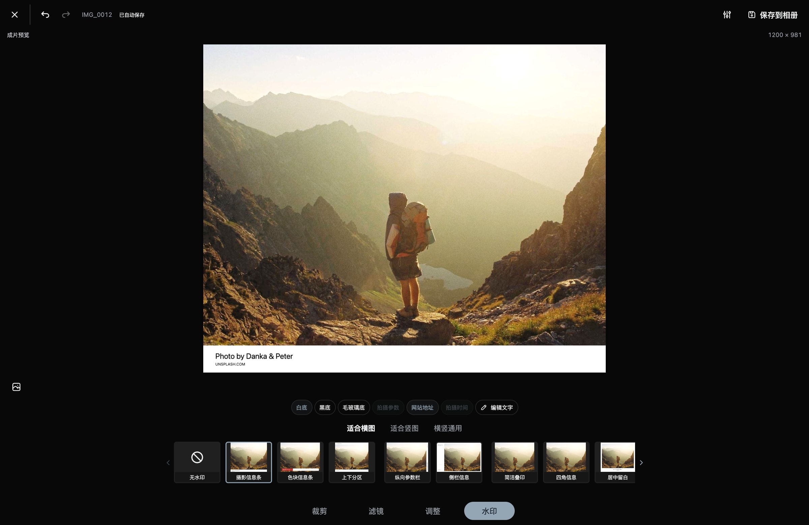
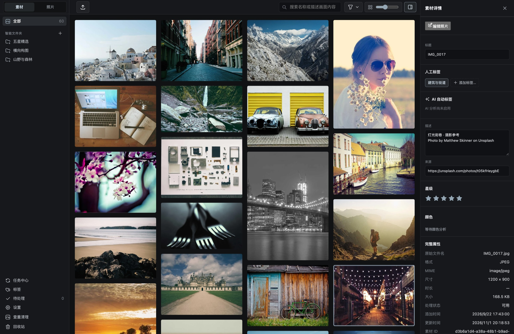
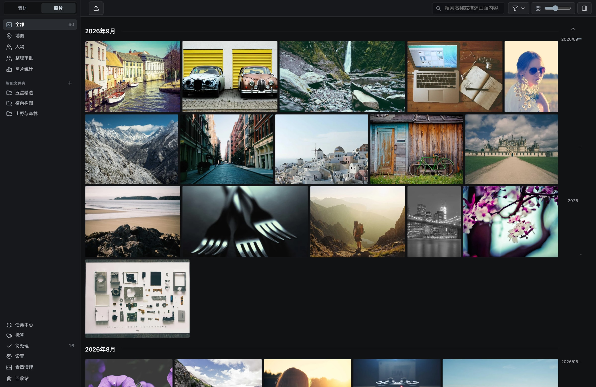
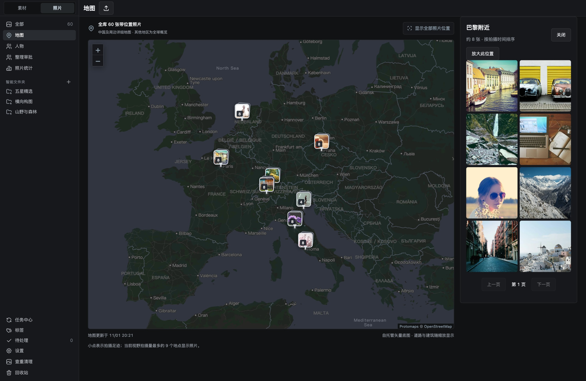

  

<h1 align="center">SekerEagle</h1>

  <a href="README.md">简体中文</a> · <strong>English</strong>

A self-hosted asset and photo manager with **Qwen3-VL-Embedding-2B content search**, local AI tagging, classification suggestions, and photo editing. Available on the web and as Windows and macOS desktop clients.

[Download](https://github.com/Seker800/SekerEagle/releases) · [Deployment](docs/operations-runbook.md) · [Import from Eagle](apps/eagle-migrator/README.md)

## Search image content

**Qwen3-VL-Embedding-2B** embeds images and text so you can search by what an image contains, without tagging it first.

Enter a description such as “buildings by the sea.” Combine content search with tags, colors, and formats to narrow the results.

## Local AI organization

- **Automatic tags**: run Qwen3-VL 8B Instruct through Ollama to identify image content and generate tags.
- **Classification suggestions**: build tag centers from manually tagged images and suggest categories for other images.
- **Batch review**: accept, adjust, or reject suggestions. You control the final tags.

Models run locally; images do not need to leave your server. AI features require separate setup and are disabled by default. The 2B embedding service runs on Apple Silicon with MLX. Uploading and browsing work without AI.

## Photo editing

- **Basic adjustments**: exposure, contrast, highlights, shadows, temperature, saturation, and more.
- **Color tools**: eight-color HSL mixer, master and RGB curves, and shadow/midtone/highlight color grading.
- **Detail tools**: dehaze, luminance and color noise reduction, sharpening, grain, and vignette.
- **Composition and filters**: free or fixed-ratio crop, rotation, mirror, and custom CUBE / PNG LUT import.
- **Photo watermarks**: frame and information layouts with editable camera details, shooting settings, and credits.

Undo, redo, compare with the original, autosave drafts, and apply editing settings to a batch. Save edits as a separate PNG while keeping the original. RAW editing uses a server-rendered copy.

## Asset management

- Tag groups, colors, ratings, and combined filters.
- Smart folders that collect matching assets automatically.
- Batch changes, trash recovery, and hidden private content.
- Import and preview images, camera RAW files, and videos; load large images by visible region.

## Photo management

- Browse by capture date; filter by EXIF, camera, and lens.
- Explore photos on a GPS map.
- Local person recognition with manual corrections.
- Burst and similar-photo groups with sharpness references.
- Shooting statistics by time, camera, and lens.

Assets and photos have separate workspaces, tags, processing settings, and trash. Use “Send to” to move items between modes.

## Capture and import

- **Drag and drop**: batch import, multipart uploads, and file deduplication.
- **Web capture**: a Chrome extension that collects original images with their page source and description.
- **Eagle migration**: preflight checks, resumable import, and result verification.

## Private hosting and shared access across devices

- Store original files and metadata on your own server. No telemetry in the default deployment.
- Access the same library from the web and desktop clients. Client caching reduces repeated downloads.
- Private content stays hidden from everyday browsing and search until you enable access.

## Get started

Deploy the server, then connect through a browser or desktop client.

- [Server deployment and local AI setup](docs/operations-runbook.md)
- [Windows / macOS downloads](https://github.com/Seker800/SekerEagle/releases)
- [Chrome capture extension](plugins/browser-capture/README.md)
- [Eagle migration](apps/eagle-migrator/README.md)
- [Supported formats](docs/camera-media.md) · [Privacy](PRIVACY.md) · [Security](SECURITY.md) · [Contributing](CONTRIBUTING.md)

Early-stage software. Back up your database and original files before upgrading. Screenshots use publicly licensed photographs with demonstration dates, locations, and camera metadata. See [image credits and capture notes](docs/screenshots/README.md).

## License

Main code: [Apache License 2.0](LICENSE). MLX embedding service: [GPL-3.0-only](services/mlx-embedding/LICENSE). See [THIRD_PARTY_NOTICES](THIRD_PARTY_NOTICES.md) for third-party components and models. Photographs in screenshots retain their original licenses.

An independent community project, not an official Eagle product.
