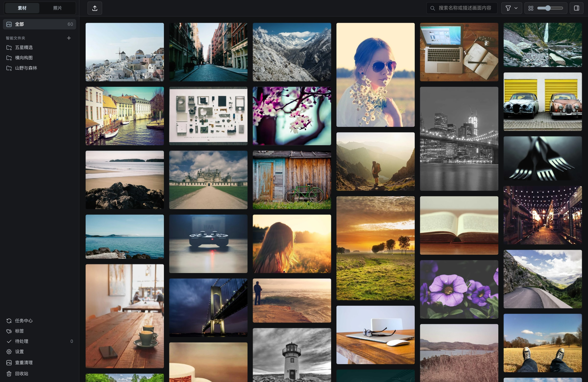
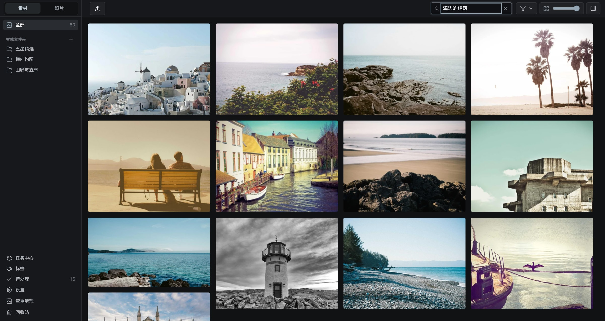
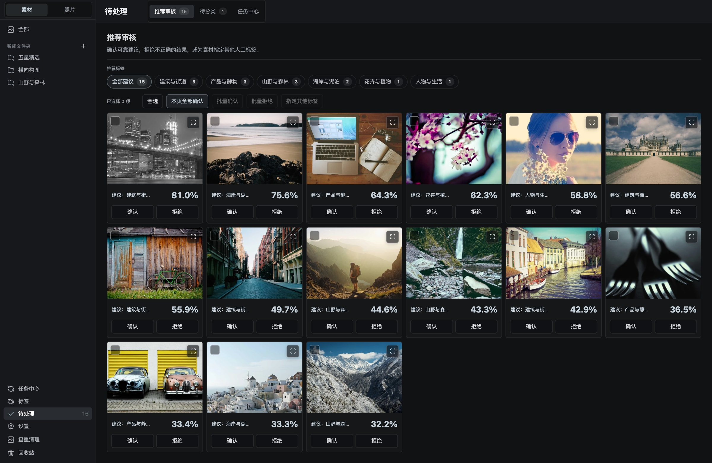
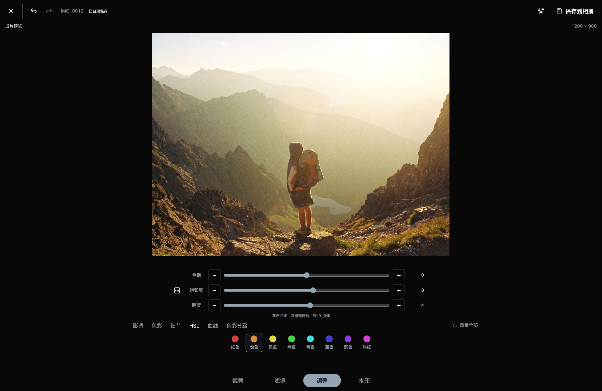
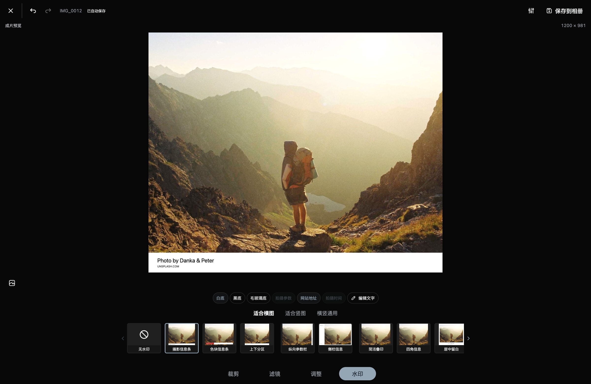
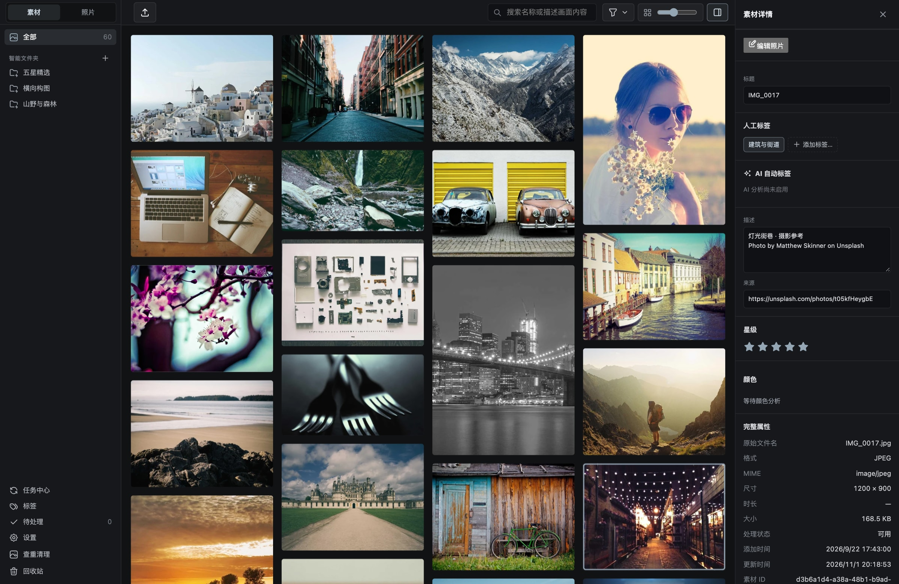
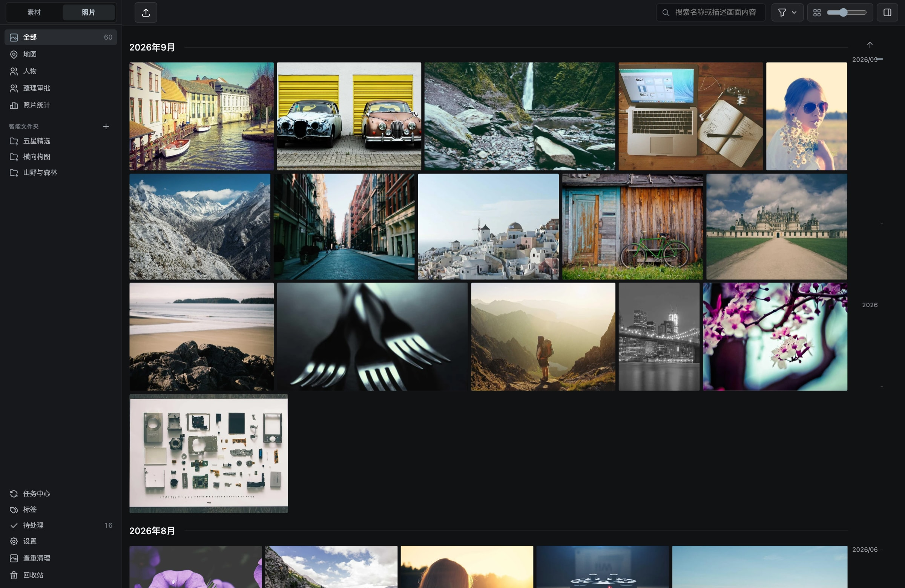
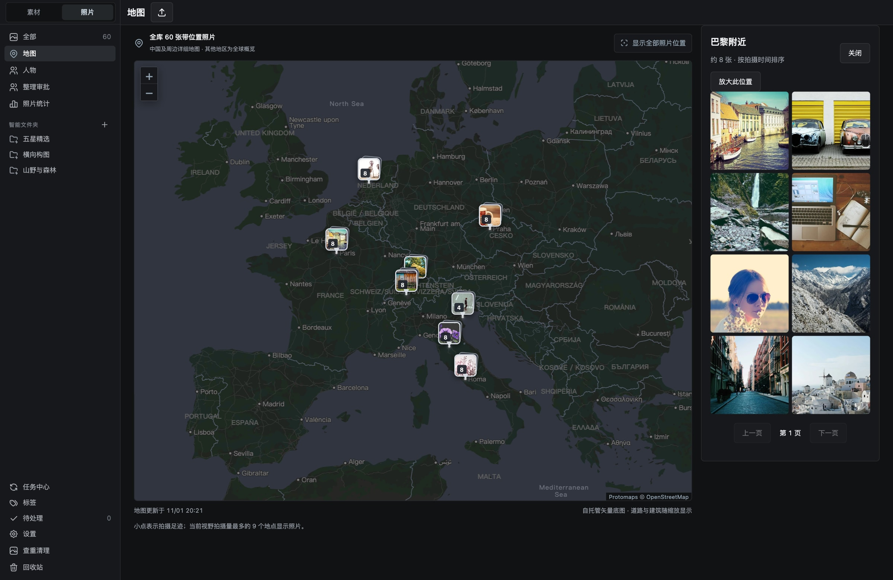

  

<h1 align="center">SekerEagle</h1>

  <strong>简体中文</strong> · <a href="README.en.md">English</a>

自托管的素材与照片管理工具。支持 **Qwen3-VL-Embedding-2B 图片内容检索**、本地自动打标签、辅助归类和照片编辑，提供网页与 Windows、macOS 桌面客户端。

[下载客户端](https://github.com/Seker800/SekerEagle/releases) · [部署指南](docs/operations-runbook.md) · [Eagle 迁移](apps/eagle-migrator/README.md)

## 图片内容检索

使用 **Qwen3-VL-Embedding-2B** 生成图片与文本向量，直接按图片内容搜索，无需提前打标签。

输入“海边的建筑”等描述，即可检索相关图片；也可结合标签、颜色、格式等条件缩小范围。

## 本地 AI 整理

- **自动标签**：通过 Ollama 运行 Qwen3-VL 8B Instruct，识别图片内容并生成标签。
- **归类建议**：根据已添加人工标签的图片计算标签中心，为其他图片推荐分类。
- **批量审核**：集中确认、调整或拒绝建议，人工标签由用户决定。

模型在本地运行，图片无需上传云端。2B 向量服务使用 Apple Silicon／MLX。AI 功能默认关闭，需单独配置；普通上传与浏览无需模型。

## 照片编辑

- **基础调整**：曝光、对比度、高光、阴影、色温、饱和度等。
- **精细调色**：HSL 八色混合器、主曲线与 RGB 曲线、阴影／中间调／高光色彩分级。
- **细节处理**：去雾、明度与色彩降噪、锐化、颗粒和晕影。
- **构图与滤镜**：自由或固定比例裁切、旋转、镜像，支持导入 CUBE／PNG LUT。
- **摄影水印**：多种边框与信息排版，可编辑机型、拍摄参数和署名文字。

支持撤销、重做、原图对比、草稿自动保存与批量套用编辑参数。保存创建独立 PNG 副本，保留原图；RAW 可编辑服务端生成的显影副本。

## 素材管理

- 标签分组、颜色、评分与组合筛选。
- 智能文件夹按规则自动收录素材。
- 批量编辑、回收站恢复与私密内容隐藏。
- 图片、相机 RAW 与视频导入和预览；超大图按区域加载。

## 照片管理

- 按拍摄日期浏览时间线，按 EXIF、相机和镜头筛选。
- 在 GPS 地图上浏览照片与拍摄位置。
- 本地人物识别，支持人工纠错。
- 连拍与相似照片分组，提供清晰度参考。
- 按时间、相机与镜头查看拍摄统计。

素材与照片使用独立工作区，标签、处理设置和回收站分别管理，可通过“发送到”在两种模式间移动。

## 收集与迁移

- **拖拽上传**：批量导入、分片上传和文件去重。
- **网页采集**：Chrome 扩展采集原图，保留页面来源与描述。
- **Eagle 迁移**：支持迁移预检、断点恢复和结果核验。

## 私有部署与多端访问

- 原文件与元数据保存在自己的服务器，默认无遥测。
- 网页与桌面客户端访问同一图库，客户端缓存减少重复加载。
- 私密内容默认从日常浏览和搜索中隐藏，手动开启后查看。

## 开始使用

先部署服务端，再通过浏览器或桌面客户端连接。

- [服务端部署与本地 AI 配置](docs/operations-runbook.md)
- [Windows / macOS 客户端下载](https://github.com/Seker800/SekerEagle/releases)
- [Chrome 采集插件](plugins/browser-capture/README.md)
- [Eagle 图库迁移](apps/eagle-migrator/README.md)
- [支持格式](docs/camera-media.md) · [隐私说明](PRIVACY.md) · [安全策略](SECURITY.md) · [贡献指南](CONTRIBUTING.md)

项目处于早期版本，升级前请备份数据库与原文件。截图使用公开授权照片；日期、位置与相机信息为演示数据，[图片来源与截图说明](docs/screenshots/README.md)。

## 许可证

主体代码采用 [Apache-2.0](LICENSE)；MLX 向量服务采用 [GPL-3.0-only](services/mlx-embedding/LICENSE)。第三方组件与模型说明见 [THIRD_PARTY_NOTICES](THIRD_PARTY_NOTICES.md)。截图中的照片遵循各自原始许可。

独立社区项目，不是 Eagle 官方产品。
